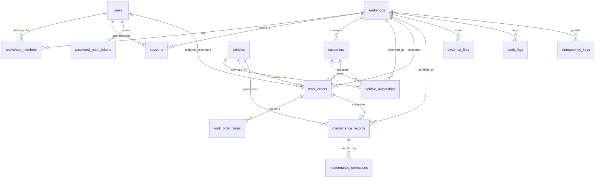

# Automotors Garage — Relational Database Architecture & Schema Specification

## 1. Architectural Principles
- **Engine**: PostgreSQL 16+.
- **ORM & Migrations**: Drizzle ORM with versioned SQL migrations (`packages/database/src/migrations/`).
- **Identity Standard**: UUID v4 primary keys (`gen_random_uuid()`) for all operational entities. The license plate is never used as the permanent primary key.
- **Strict Multi-Tenancy**: All workshop-scoped records include a mandatory `workshop_id` foreign key with indexed compound keys `(workshop_id, id)`.
- **Inward Clean Architecture**: Drizzle schemas live exclusively in `@automotors/database` and repository adapters in `apps/backend/src/infrastructure/database/`. Domain entities and Application use cases contain zero ORM or SQL dependencies.

---

## 2. Entity Relationship Diagram (ERD)

---

## 3. Relational Table Specifications

### A. Identity & Multi-Tenant Access Control (IAM)
1. **`users`**: User identity accounts.
   - `id` UUID PK, `email` VARCHAR UNIQUE, `password_hash` VARCHAR (Argon2id), `full_name` VARCHAR, `phone` VARCHAR, `is_active` BOOLEAN, `created_at` TIMESTAMPTZ, `updated_at` TIMESTAMPTZ.
2. **`workshops`**: Tenant boundary representing garages / repair centers.
   - `id` UUID PK, `name` VARCHAR, `legal_name` VARCHAR, `tax_id` VARCHAR, `address` TEXT, `phone` VARCHAR, `email` VARCHAR, `is_active` BOOLEAN, `created_at` TIMESTAMPTZ, `updated_at` TIMESTAMPTZ.
3. **`workshop_members`**: Multi-tenant association between users and workshops.
   - `id` UUID PK, `workshop_id` UUID FK -> workshops, `user_id` UUID FK -> users, `role` VARCHAR (SUPER_ADMIN, WORKSHOP_OWNER, WORKSHOP_MANAGER, MECHANIC, VEHICLE_OWNER), `is_active` BOOLEAN.
   - Constraint: `UNIQUE(workshop_id, user_id)`.
4. **`sessions`**: Persistent authenticated user sessions.
   - `id` UUID PK, `user_id` UUID FK -> users, `active_workshop_id` UUID FK -> workshops (nullable), `refresh_token_hash` VARCHAR, `expires_at` TIMESTAMPTZ, `is_revoked` BOOLEAN, `revoked_at` TIMESTAMPTZ, `ip_address` VARCHAR, `user_agent` TEXT.
5. **`password_reset_tokens`**: Single-use cryptographic recovery tokens.
   - `id` UUID PK, `user_id` UUID FK -> users, `token_hash` VARCHAR, `expires_at` TIMESTAMPTZ, `is_consumed` BOOLEAN, `consumed_at` TIMESTAMPTZ.

### B. Vehicle Registry & Ownership
6. **`vehicles`**: Central physical vehicle catalog.
   - `id` UUID PK, `vin` VARCHAR(17) UNIQUE, `plate` VARCHAR(20), `make` VARCHAR, `model` VARCHAR, `year` INTEGER, `engine` VARCHAR, `fuel_type` VARCHAR, `current_mileage` INTEGER CHECK (current_mileage >= 0), `metadata` JSONB.
7. **`vehicle_ownerships`**: Historical ownership linkage.
   - `id` UUID PK, `vehicle_id` UUID FK -> vehicles, `customer_id` UUID FK -> customers, `workshop_id` UUID FK -> workshops, `is_current_owner` BOOLEAN, `start_date` TIMESTAMPTZ, `end_date` TIMESTAMPTZ.
8. **`vehicle_access_grants`**: Granular cross-workshop history sharing.
   - `id` UUID PK, `vehicle_id` UUID FK -> vehicles, `granter_user_id` UUID FK -> users, `granted_workshop_id` UUID FK -> workshops, `permission_level` VARCHAR, `expires_at` TIMESTAMPTZ, `is_revoked` BOOLEAN.

### C. Workshop Operations & Service Orders
9. **`customers`**: Workshop customer portfolio.
   - `id` UUID PK, `workshop_id` UUID FK -> workshops, `first_name` VARCHAR, `last_name` VARCHAR, `phone` VARCHAR, `email` VARCHAR, `document_id` VARCHAR, `notes` TEXT.
10. **`work_orders`**: Repair orders and workflow transitions.
    - `id` UUID PK, `workshop_id` UUID FK -> workshops, `vehicle_id` UUID FK -> vehicles, `customer_id` UUID FK -> customers, `assigned_mechanic_id` UUID FK -> users (nullable), `status` VARCHAR, `reported_mileage` INTEGER CHECK (reported_mileage >= 0), `reported_issue` TEXT, `initial_condition` TEXT, `diagnosis` TEXT, `internal_notes` TEXT, `parts_cost` NUMERIC, `labor_cost` NUMERIC, `version` INTEGER, `closed_at` TIMESTAMPTZ.
11. **`work_order_items`**: Line-item interventions and operations.
    - `id` UUID PK, `work_order_id` UUID FK -> work_orders, `title` VARCHAR, `category` VARCHAR, `description` TEXT, `cost` NUMERIC, `is_approved` BOOLEAN.

### D. Vehicle History Ledger (Immutable Passport)
12. **`maintenance_records`**: Certified maintenance projection ledger.
    - `id` UUID PK, `vehicle_id` UUID FK -> vehicles, `work_order_id` UUID FK -> work_orders, `performing_workshop_id` UUID FK -> workshops, `performing_workshop_name` VARCHAR, `service_date` TIMESTAMPTZ, `recorded_mileage` INTEGER, `verification_level` VARCHAR, `is_certified` BOOLEAN, `criteria_met` JSONB, `interventions` JSONB, `evidence_asset_ids` JSONB, `internal_notes` TEXT, `parts_cost` NUMERIC, `labor_cost` NUMERIC.
13. **`maintenance_corrections`**: Non-destructive append-only audit corrections.
    - `id` UUID PK, `record_id` UUID FK -> maintenance_records, `actor_id` UUID FK -> users, `actor_name` VARCHAR, `reason` TEXT, `previous_data` JSONB, `corrected_data` JSONB.
14. **`maintenance_intervals`**: Technical service rules per model and engine.
    - `id` UUID PK, `make` VARCHAR, `model` VARCHAR, `year` INTEGER, `engine` VARCHAR, `category` VARCHAR, `interval_km` INTEGER, `interval_months` INTEGER, `source_citation` VARCHAR.

### E. Security, Idempotency & Outbox Infrastructure
15. **`evidence_files`**: Vault for photographic and documentary proof.
    - `id` UUID PK, `workshop_id` UUID FK -> workshops, `work_order_id` UUID FK -> work_orders, `vehicle_id` UUID FK -> vehicles, `storage_key` TEXT, `file_name` VARCHAR, `mime_type` VARCHAR, `file_size_bytes` BIGINT, `sha256_hash` VARCHAR, `is_private` BOOLEAN.
16. **`audit_logs`**: Security and access audit trail.
    - `id` UUID PK, `workshop_id` UUID FK -> workshops, `user_id` UUID FK -> users, `event_type` VARCHAR, `outcome` VARCHAR, `resource_type` VARCHAR, `resource_id` VARCHAR, `action` VARCHAR, `details` JSONB, `ip_address` VARCHAR.
17. **`idempotency_keys`**: Concurrency and retry deduplication.
    - `key` VARCHAR, `workshop_id` UUID FK -> workshops, `locked_at` TIMESTAMPTZ, `response_code` INTEGER, `response_body` JSONB, `expires_at` TIMESTAMPTZ.
    - Constraint: `UNIQUE(key, workshop_id)`.
18. **`outbox_events`**: Guaranteed transactional event publishing.
    - `id` UUID PK, `event_type` VARCHAR, `aggregate_type` VARCHAR, `aggregate_id` VARCHAR, `payload` JSONB, `status` VARCHAR (PENDING, PUBLISHED, FAILED), `retry_count` INTEGER.
