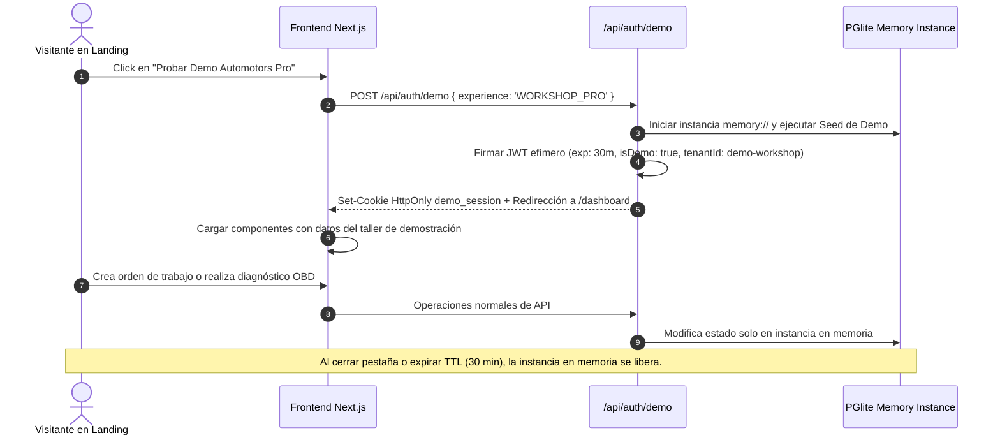

# Arquitectura Técnica para Demos Interactivas Aisladas

> **Estado**: Plan de Diseño Arquitectónico (Fase J — Milestone 15.1)  
> **Ámbito**: Demos públicas de autoservicio para la Landing Page de Automotors Garage  
> **Objetivo**: Permitir a visitantes experimentar el software real sin fricción de registro, con total aislamiento de datos y sin riesgo de seguridad.

---

## 1. Principios de Diseño

1. **Reutilización del 100% de la UI Real**:
   - Las demos no son maquetas estáticas en Figma ni capturas animadas; ejecutan los mismos componentes React 19 de producción (`MiAutomotorsView`, `WorkOrdersView`, `DiagnosticsView`, `QuickServiceEntry`, `VehiclesView`).
2. **Cero Persistencia Cruzada (Aislamiento Absoluto)**:
   - Las sesiones de demo no tocan la base de datos persistente del taller ni los datos de desarrollo.
   - Operan sobre un almacén efímero en memoria (`memory://` en PGlite) o mock enriquecido por sesión, destruido automáticamente al cerrar la pestaña o expirar el tiempo de vida (TTL 30 min).
3. **Principio de Mínimo Privilegio**:
   - En ninguna demo se asigna el rol `SUPER_ADMIN`.
   - Demo Mi Automotors opera estrictamente con `VEHICLE_OWNER` (`activeTenantId: null`).
   - Demo Automotors Pro opera como `WORKSHOP_ADMIN` dentro de un taller de demostración aislado (`tenantId: '00000000-0000-0000-0000-000000000001'`).
4. **Acceso Inmediato en 1-Click**:
   - Sin formularios de registro, sin tarjetas de crédito, sin validación de email. Un click genera la sesión efímera pre-poblada con un set de datos realista.

---

## 2. Flujo de Activación y Sesión Efímera

---

## 3. Especificación de Experiencias

### 3.1 Demo A: Mi Automotors (Experiencia Propietario)
- **Ruta de Acceso**: `/demo/propietario`
- **Rol Asignado**: `VEHICLE_OWNER`
- **Datos Semilla Precargados**:
  - Vehículo 1: **Toyota Corolla Hybrid 2021** (Patente `AF123CD`, 38.500 km) con historial completo de services certificados y cambio reciente de aceite y filtros.
  - Vehículo 2: **Ford Ranger 4x4 2019** (Patente `AD456EF`, 72.000 km) con alerta preventiva de cambio de pastillas de freno y líquido refrigerante próximo a vencer.
- **Acciones Disponibles para el Visitante**:
  - Registrar un nuevo vehículo particular en su garaje.
  - Declarar un mantenimiento propio con validación de odómetro en tiempo real.
  - Inspeccionar el historial cronológico y probar la corrección auditable.
  - Consultar las alertas preventivas determinísticas e interactuar con la explicación asistida de mantenimiento.

### 3.2 Demo B: Automotors Pro (Experiencia Taller)
- **Ruta de Acceso**: `/demo/taller`
- **Rol Asignado**: `WORKSHOP_ADMIN`
- **Tenant Asignado**: `Taller Mecánico Modelo — Garage Pro Centro`
- **Datos Semilla Precargados**:
  - 3 Clientes habituales con información de contacto y vehículos asociados.
  - 4 Órdenes de trabajo activas en distintos estados:
    - 1 en `IN_PROGRESS` (diagnóstico de tren delantero).
    - 1 en `WAITING_APPROVAL` (presupuesto de embrague).
    - 1 en `READY_FOR_DELIVERY` (afinación de inyección y bujías).
    - 1 en `CLOSED` (service de 50.000 km con odómetro certificado).
  - 1 Caso de diagnóstico OBD-II precargado con código de falla SAE P0300 (falla de encendido múltiple) y freeze frame de temperatura y RPM.
- **Acciones Disponibles para el Visitante**:
  - Utilizar **Quick Service Entry** para recibir un vehículo y cerrar un servicio de aceite y filtros en menos de 60 segundos.
  - Cambiar de estado una orden de trabajo y realizar el cierre transaccional.
  - Explorar el decodificador de fallas OBD-II y generar el checklist técnico para el mecánico.

---

## 4. Salvaguardas de Seguridad y Resiliencia

1. **Bandera `isDemo: true` en Token JWT**:
   - Todo request proveniente de una demo lleva la marca `isDemo: true`.
   - Los guards del backend impiden que una sesión de demo invoque endpoints de administración de plataforma, configuración de suscripciones o mutación de talleres reales.
2. **Limitación de Tasa (Rate Limiting)**:
   - Máximo 30 requests por minuto por IP para prevenir abuso o saturación de instancias en memoria.
3. **Recolección Automática de Basura**:
   - Las instancias efímeras de PGlite en memoria no persisten en disco; se desechan al terminar la sesión o tras 30 minutos de inactividad, garantizando consumo mínimo de RAM en el servidor.
