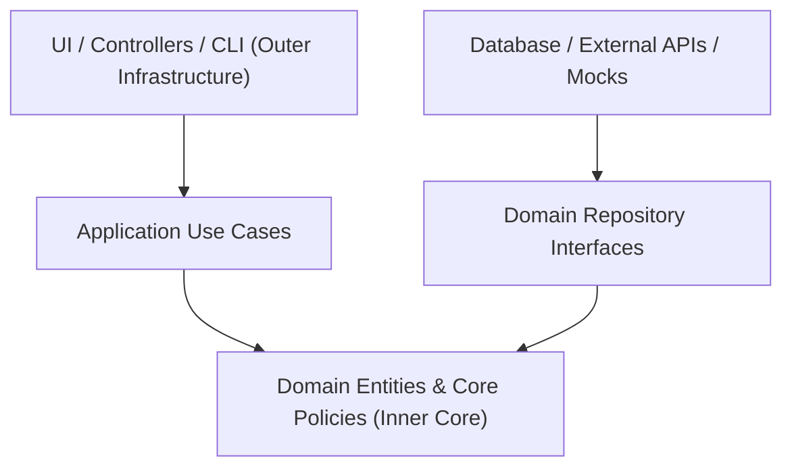
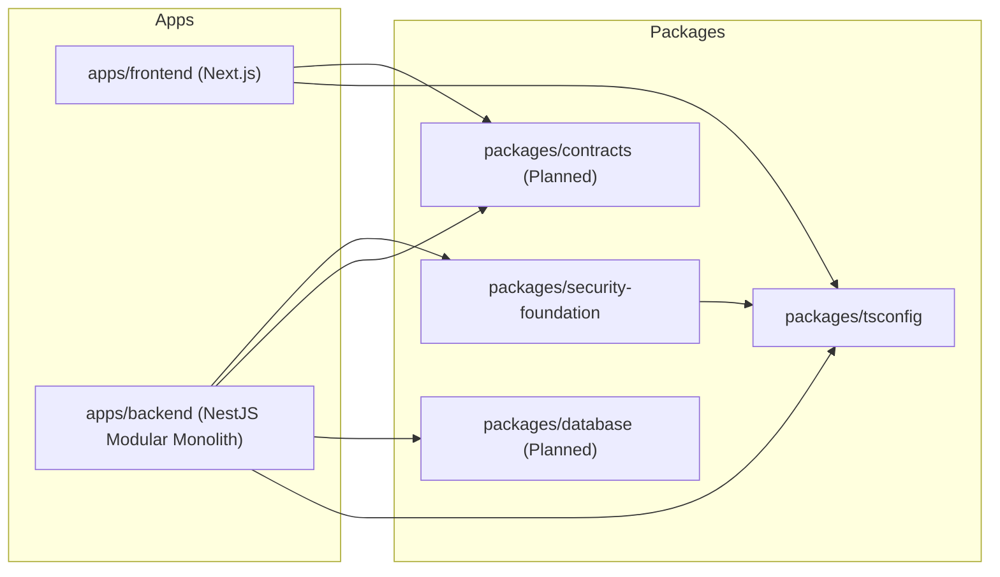

# Automotors Garage — Dependency Map & Inward Architecture Rules

## 1. Clean Architecture Dependency Inversion Rule

The golden rule of Automotors Garage architecture is **strict inward dependency direction**:
Outer layers depend on inner layers. Inner layers **never** know about outer layers.

### Prohibited Cross-Layer Imports (Zero-Tolerance Invariants)
- **Domain entities** MUST NEVER import from `@nestjs/*`, `drizzle-orm`, `react`, or database drivers.
- **Domain repositories** MUST NEVER import concrete adapter implementations.
- **Use Cases** interact with storage ONLY through domain repository interfaces (Ports).
- **Frontend components** MUST NEVER bypass `ApiClient` to write custom in-line fetch calls.

---

## 2. Monorepo Package Graph

---

## 3. Package Dependency Matrix

| From (Consumer) | To (Target) | Allowed? | Purpose / Rule |
| :--- | :--- | :--- | :--- |
| `apps/backend` | `packages/security-foundation` | **YES** | Multi-tenant auth guards, token validation, permission checks. |
| `apps/backend` | `packages/contracts` | **YES** | Request validation pipes and DTO contracts. |
| `apps/backend` | `packages/database` | **YES** | Concrete Drizzle ORM repository implementations. |
| `apps/frontend` | `packages/contracts` | **YES** | React Hook Form schemas and API response types. |
| `packages/security-foundation` | `apps/backend` | **NO** | Security kernel must remain decoupled from specific backend apps. |
| `packages/security-foundation` | `drizzle-orm` | **NO** | Security kernel handles logic and tokens in memory/crypto, not DB. |
| `apps/frontend` | `apps/backend` | **NO** | Frontend communicates with backend exclusively over HTTP/REST. |

---

## 4. Cross-Module Communication Pattern

Within `apps/backend`, bounded contexts communicate using:
1. **Direct Use Case Invocation via Dependency Injection**: When synchronous execution is required within the same transaction (e.g. `CloseWorkOrderUseCase` invokes `IMaintenanceHistoryRepository.saveRecord`).
2. **Domain Events (In-Memory Event Emitter)**: For decoupled asynchronous side effects:
   - `WorkOrderClosedEvent` -> Triggers notification to vehicle owner & recalculates preventive maintenance interval schedule.
   - `VehicleCreatedEvent` -> Initializes empty vehicle passport projection.
