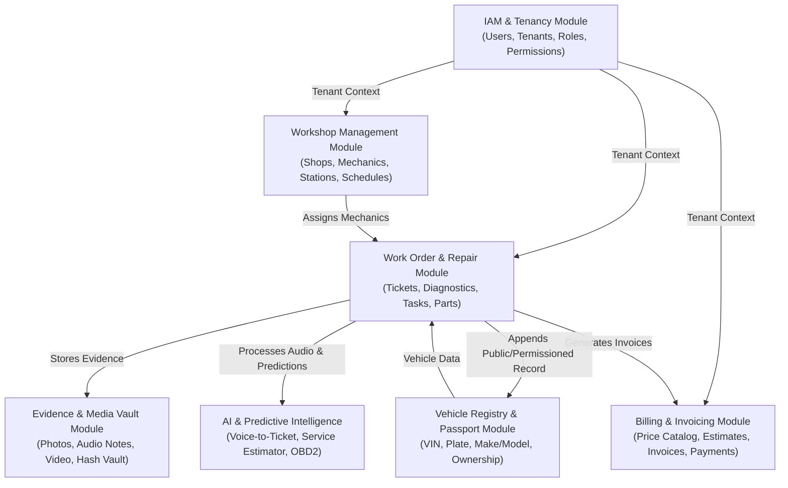

# Bounded Contexts & Module Map

This document outlines the bounded contexts and domain modules of **Automotors Garage**, their responsibilities, aggregates, and interaction rules.

---

## Bounded Contexts

---

## Module Specifications

### 1. IAM & Multi-Tenancy (`modules/iam`)
- **Entities**: `Tenant` (Workshop Organization), `User`, `Role`, `Permission`, `Session`.
- **Responsibilities**:
  - Organization and branch onboarding.
  - User authentication via Argon2id hashed credentials and short-lived JWTs.
  - Role-based and attribute-based authorization (RBAC/ABAC).
  - Enforcing tenant boundary context across requests.

### 2. Workshop Management (`modules/workshop`)
- **Entities**: `Workshop`, `Branch`, `Station/Bay`, `MechanicProfile`, `WorkingHours`.
- **Responsibilities**:
  - Physical shop and bay configuration.
  - Mechanic scheduling, skills, and assignment.
  - Capacity planning.

### 3. Vehicle Registry & Passport (`modules/vehicle`)
- **Entities**: `Vehicle`, `VehicleOwner`, `VehiclePassport`, `MaintenanceSchedule`.
- **Responsibilities**:
  - VIN validation and plate indexing.
  - Vehicle specifications (Make, Model, Year, Engine, Transmission).
  - Mileage tracking and history logging.
  - Public/Permissioned digital passport generation (QR codes for vehicle owners/buyers).

### 4. Work Order & Repair (`modules/work-order`)
- **Entities**: `WorkOrder`, `WorkOrderItem`, `DiagnosisReport`, `Checklist`, `StatusTransition`.
- **Responsibilities**:
  - Lifecycle management: `DRAFT` -> `RECEIVED` -> `IN_DIAGNOSIS` -> `AWAITING_APPROVAL` -> `IN_PROGRESS` -> `QUALITY_CHECK` -> `READY_FOR_PICKUP` -> `COMPLETED` -> `CLOSED`.
  - Itemized labour and parts accounting.
  - Audit logging of all stage transitions and technician signatures.

### 5. Evidence & Media Vault (`modules/evidence`)
- **Entities**: `EvidenceAsset`, `AssetChecksum`, `StorageMetadata`.
- **Responsibilities**:
  - Pre-repair and post-repair photographic evidence.
  - Audio recording storage for voice notes.
  - Content-addressable SHA-256 hash calculation for non-repudiation.
  - Presigned S3/MinIO upload and download authorization.

### 6. AI & Predictive Intelligence (`modules/ai`)
- **Entities**: `TranscriptionJob`, `PredictiveInspectionRule`, `AIPromptLog`.
- **Responsibilities**:
  - Speech-to-text pipeline for mechanic voice notes using Whisper.
  - Extraction of symptoms, requested services, and parts from natural language.
  - Predictive maintenance calculator based on vehicle mileage, elapsed time, and manufacturer telemetry.

### 7. Billing & Invoicing (`modules/billing`)
- **Entities**: `PriceCatalogItem`, `Estimate/Quote`, `Invoice`, `PaymentReceipt`.
- **Responsibilities**:
  - Workshop standard price books and labour rates.
  - Quotation generation for customer approval (via SMS/WhatsApp/Email links).
  - Final invoice computation, tax handling, and payment tracking.

---

## Inter-Module Communication Invariants
1. **No Direct Entity Access**: Module A must never query the database tables or models of Module B directly.
2. **Synchronous Boundaries**: Use exported Application Service Interfaces or Façades for read operations across modules.
3. **Asynchronous Events**: State changes (e.g., `WorkOrderCompletedEvent`) emit in-process domain events handled by listening modules to preserve decoupling.
