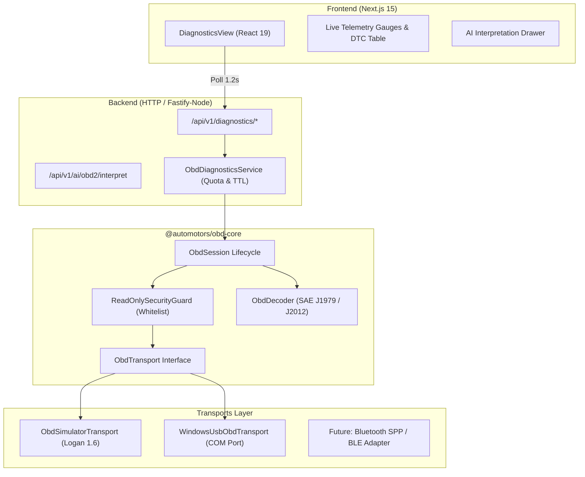

# Architecture Specification: OBD-II Diagnostics Foundation

## 1. System Overview & Hexagonal Decoupling

The **Automotors Diagnostics** engine is implemented as a standalone, framework-agnostic core domain package (`@automotors/obd-core`) consumed by the NestJS/HTTP backend monolith and rendered in real time by the Next.js 15 frontend application.

---

## 2. Read-Only Security Policy & Whitelist Validation

To safeguard vehicle ECUs against unintended states, accidental DTC clearing, or catastrophic actuator activation, `@automotors/obd-core` enforces a **deny-by-default read-only security guard** (`validateAndSanitizeCommand`):

### 2.1 Whitelisted Commands
- **AT Commands**: `ATZ` (Reset), `ATE0` / `ATE1` (Echo), `ATL0` / `ATL1` (Linefeeds), `ATH0` / `ATH1` (Headers), `ATSP0` (Auto protocol), `ATSP6` (ISO 15765-4 CAN 11-bit 500k), `ATDP` (Describe protocol), `ATRV` (Battery voltage), `ATBD` (Buffer dump).
- **Mode 01 (Current Powertrain Diagnostic Data)**:
  - `0100`: Supported PIDs `[01-20]`
  - `0101`: Status since DTCs cleared (MIL state + DTC count)
  - `0104`: Calculated engine load (`%`)
  - `0105`: Engine coolant temperature (`°C`)
  - `010C`: Engine RPM (`RPM`)
  - `010D`: Vehicle speed (`km/h`)
  - `010E`: Timing advance (`°`)
  - `010F`: Intake air temperature (`°C`)
  - `0111`: Throttle position (`%`)
  - `011C`: OBD standard conformance
  - `0120`: Supported PIDs `[21-40]`
- **Mode 03**: Stored Diagnostic Trouble Codes (Confirmed DTCs).
- **Mode 07**: Pending Diagnostic Trouble Codes (Detected during current/previous driving cycle).
- **Mode 09**: Vehicle Information (`0900`, `0902` - VIN Vehicle Identification Number).

### 2.2 Prohibited Commands (Enforced with `ObdSecurityError`)
- **Mode 04 (`04`)**: Clear / Reset Emission-Related Diagnostic Information. **Strictly blocked.**
- **Mode 08 (`08 XX`)**: Control of On-Board Systems / Actuators. **Strictly blocked.**
- **UDS / ISO 14229 Write Services**: Mode `0x2E` (WriteDataByIdentifier), Mode `0x3D` (WriteMemoryByAddress), Mode `0x34` (RequestDownload / Flashing). **Strictly blocked.**

---

## 3. Reference Vehicle Engineering: Renault Logan 1.6 (2020)

### 3.1 Technical Characteristics & Assumptions
- **Model**: Renault Logan II (Phase 2, Argentine / Mercosur market, ~2020).
- **Probable Engine**: **H4M / HR16DE** (1.6L 16V 115 CV, DOHC, chain timing, multipoint sequential injection). Prior models featured the K7M (1.6L 8V 85 CV). The system does not hardcode engine type, allowing dynamic detection.
- **Bus Architecture**: High-Speed CAN Bus (500 kbaud, 11-bit identifiers) compliant with **ISO 15765-4 CAN**.
- **ELM327 Protocol Configuration**: `ATSP6` (ISO 15765-4 CAN 11/500).

### 3.2 High-Fidelity Simulator
The simulator (`ObdSimulatorTransport`) emulates realistic Logan 1.6 physics and sensor telemetry:
- Idle RPM oscillating around 750 ± 35 RPM, throttle response up to 3,200 RPM.
- Speed progressing dynamically between 0 and 68 km/h.
- Coolant temperature warming up from 72°C to normal operating threshold (89°C - 92°C).
- Battery voltage simulating alternator charging (13.8V - 14.2V).
- Fault injection engine supporting `NO_DATA`, `UNABLE_TO_CONNECT`, `BUS_BUSY`, and `TIMEOUT`.
- Every simulated payload explicitly carries `isSimulated: true`.

---

## 4. Decoder Architecture: SAE J1979 & SAE J2012

- **Hex Math Conversions**:
  - **RPM**: `((A * 256) + B) / 4`
  - **Speed**: `A` km/h
  - **Coolant Temperature**: `A - 40` °C
  - **Engine Load / Throttle**: `(A * 100) / 255` %
  - **Voltage**: Parsed from ELM327 `ATRV` analog ADC output (e.g. `14.1V`).
- **DTC Byte Extraction (SAE J2012 / ISO 15031-6)**:
  - 2-byte pairs decoded into alphanumeric codes:
    - First 2 bits define category: `00` -> `P` (Powertrain), `01` -> `C` (Chassis), `10` -> `B` (Body), `11` -> `U` (Network).
    - Next 2 bits define standard vs manufacturer: `0` -> ISO/SAE, `1` -> Manufacturer-specific.
    - Remaining bits formatted as hex digits (e.g., `0300` -> `P0300`).

---

## 5. Non-Destructive Vehicle History Integration

The OBD-II diagnostics engine adheres to the core immutability invariants of Automotors Garage:
1. **Diagnostic Record Separation**: Diagnostic snapshots are stored as diagnostic observations (`DiagnosticRecord`), never as completed repairs.
2. **Odometer Protection**: A live OBD-II scan does not alter a vehicle's recorded odometer unless verified through explicit mechanic confirmation.
3. **Auditability**: Records explicitly log origin (`SIMULATED` vs `USB_SERIAL_ELM327`), timestamp, and technician notes.

---

## 6. AI Assisted Diagnostics Protocol

- **Use Case**: `InterpretObd2UseCase` processes active DTC codes and vehicle specifications.
- **Output**: Urgency classification (`IMMEDIATE_ACTION`, `ATTENTION_NEEDED`, `MONITOR`), systemic vehicle impact explanation, and step-by-step physical inspection checklist.
- **Mandatory Safety Disclaimer**: Emphasizes that AI recommendations are strictly advisory and non-binding, requiring manual verification by a certified technician prior to parts replacement.

---

## 7. Hardware Security, Session Governance & Resource Quotas

To prevent physical hardware locking, port exhaustion, or unauthenticated manipulation:
1. **Authentication & Tenant Guard**: All diagnostics endpoints (`/api/v1/diagnostics/*`) require a valid Bearer JWT. The target vehicle must belong to an active workshop membership.
2. **Strict Port Identification**: COM ports must match `^COM[0-9]{1,2}$` regex format. Arbitrary file or device paths (`/dev/*`, `\\.\*`) are rejected with HTTP 400.
3. **Inactivity TTL & Automatic Cleanup**: Active diagnostic sessions maintain a `lastAccessedAt` timestamp. Sessions abandoned for > 5 minutes (300,000 ms) are automatically closed and evicted.
4. **Workshop Concurrency Quota**: Each workshop is limited to a maximum of 3 concurrent live diagnostic sessions to prevent server resource saturation.

---

## 8. Architectural Evaluation: Local Companion Agent vs Cloud Hardware Access

In cloud-hosted SaaS environments (multi-tenant containers in Kubernetes/Docker):
- **Server Hardware Risk**: Direct access from a web server to local hardware serial ports is an anti-pattern. The central cloud server cannot physically reach a vehicle parked in a mechanic's bay.
- **Local Agent Pattern (Target Architecture)**:
  - In local development mode on Windows, the direct COM port adapter (`WindowsUsbObdTransport`) connects directly.
  - In cloud production, the frontend will leverage either:
    1. **Web Serial API** (`navigator.serial`): Native browser-to-USB communication running client-side with zero server hardware exposure.
    2. **Automotors Companion Agent**: A lightweight background daemon (`automotors-agent`) running on the technician's workstation on `127.0.0.1:9100`, streaming telemetry securely over HTTPS/WSS to the central SaaS backend.
  - This architecture ensures that **central cloud servers never expose physical serial devices to the network**.

---

## 9. Telemetry Invariants & Battery Voltage Disclaimer

- **Adapter Voltage (`ATRV`) Limitation**:
  - The voltage reported by the ELM327 adapter is measured by an uncalibrated internal analog resistor divider on Pin 16 of the OBD port.
  - **Critical Invariant**: Voltage readings are purely indicative of rail/alternador line voltage and **must never be presented as a certified battery health (State of Health - SOH) or cold cranking amps (CCA) test**.
  - A battery with a dead cell can show 12.6V resting voltage and immediately collapse under starter load. Certified battery testing requires dedicated carbon-pile or conductance testers.
