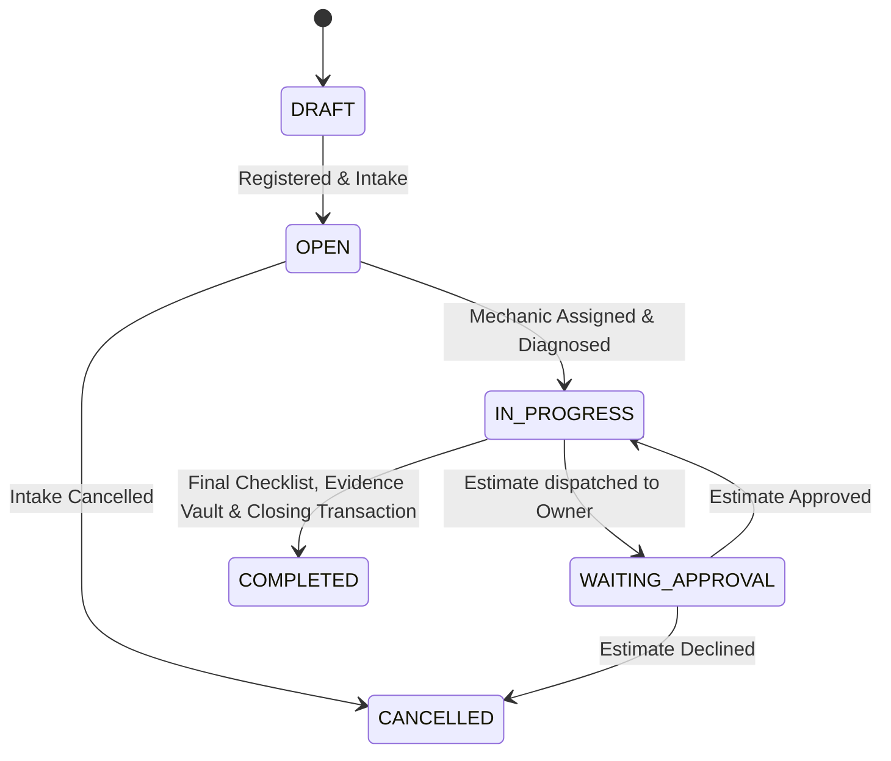

# Vehicle History & Audit Engine Architecture

## 1. Overview & Core Philosophy
The **Vehicle History Engine** is the auditable heart of **Automotors Garage**. It ensures that every maintenance intervention performed across workshops, fleet services, or individual repairs is recorded deterministically, immutably, and with cryptographic verification guarantees.

---

## 2. Vehicle Identity Design
- **Independent Internal Identity**: Vehicles are permanently identified by an internal immutable UUID (`id`).
- **Separation from License Plates**: License plates change upon transfer, re-registration, or jurisdiction movement. The vehicle's identity is bound to its internal ID and manufacturer VIN/chassis number.
- **Duplicate Detection**:
  - `EXACT_CONFLICT`: If an existing vehicle has the same normalized VIN, creation is rejected.
  - `POTENTIAL_CONFLICT`: If an existing vehicle shares the same normalized Plate and Make, a warning is emitted for manual verification or ownership transfer workflows.

---

## 3. Work Order State Lifecycle & Invariants

### Invariants:
1. **No Silent Modifications**: Once a work order reaches `COMPLETED` or `CANCELLED`, direct property mutations are blocked.
2. **Audit Corrections**: Post-closing corrections require an `AppendCorrection` workflow specifying `actorId`, `origin`, `timestamp`, `reason`, and a diff of `oldValue -> newValue`.
3. **Optimistic Concurrency**: Every entity maintains an incremental `version` attribute. Concurrent stale saves throw an optimistic concurrency conflict.

---

## 4. Verification Levels & Certification Rules

| Level | Definition | Certification Status | Verifiable Criteria |
| :--- | :--- | :--- | :--- |
| `DECLARED` | Self-reported by vehicle owner without shop proof | **Uncertified** | Owner input only; zero supporting documents. |
| `DOCUMENTED` | External workshop invoice/receipt attached | **Uncertified** | PDF/photo receipt attached from unregistered external shop. |
| `IDENTIFIED_WORKSHOP` | Executed by verified workshop in Automotors | **Certified** | Performed within an active registered tenant with verified mechanic ID. |
| `CORROBORATED` | Executed by registered shop + cryptographic evidence | **Certified** | Registered workshop + SHA-256 evidence vault photos/diagnostic data. |

> [!IMPORTANT]
> The engine **never** presents `DECLARED` or `DOCUMENTED` records as certified to external buyers or insurers.

---

## 5. Privacy Partitioning on Vehicle Passport

When a vehicle's passport is requested:
1. **Public View (`isPublicView: true`)**:
   - Exposed to prospective buyers scanning a QR code.
   - Includes: Date, recorded mileage, service type, verifying workshop name, verification level, and whether photographic evidence exists.
   - **Strictly Redacted**: Mechanic internal notes, parts cost, labor cost, profit margin, customer contact details (phone, email, tax ID).
2. **External Workshop View**:
   - When Workshop A inspects a vehicle that previously had service at Workshop B:
   - Workshop A sees the verified historical milestones of Workshop B, but Workshop B's private notes and financial margins are completely redacted.
3. **Originating Workshop View**:
   - Workshop A sees its own internal notes, exact part serial numbers, and cost breakdowns.
