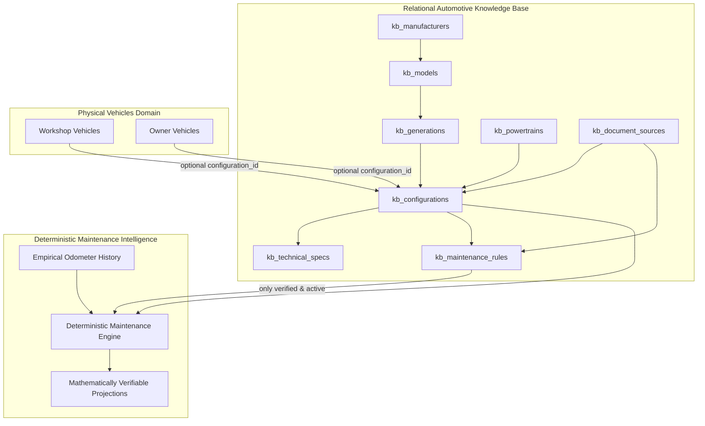

# Architecture: Vehicle Knowledge Base (KB)

## 1. System Overview & Context

Automotors Garage integrates an authoritative, verifiable **Vehicle Knowledge Base (KB)**. Prior to this milestone, maintenance intervals relied on hardcoded generic rules or AI predictions. To guarantee engineering safety, legal compliance, and customer trust, mechanical specifications and maintenance intervals must be rooted in verified OEM documentary sources (workshop manuals, official maintenance books, factory technical service bulletins).

The Knowledge Base is implemented as a relational subsystem within the existing PostgreSQL/PGlite database using Drizzle ORM, preserving monorepo architecture without introducing external microservices or third-party catalog dependencies.

---

## 2. Core Architectural Principles

### 2.1. Separation of Static Ground-Truth and Physical Instances
- **Technical Catalog (`kb_*`)**: Represents immutable/versioned mechanical truths (e.g. *Renault Logan II Phase 2 1.6 16v SCe H4M with timing chain*).
- **Physical Vehicle (`vehicles`)**: Represents an actual asset owned by a customer or serviced by a workshop, identified by license plate, VIN, and current odometer.
- **Loose Coupling via Foreign Key (`configuration_id`)**: A vehicle references an optional `configuration_id`. When unassigned, the platform falls back to generic category heuristics while prompting the user or technician to confirm an exact homologation.

### 2.2. Deterministic Calculation Over Generative AI
- **Strict Prohibition**: Generative AI (LLMs) must **never** be the source of truth for mechanical intervals, fluid capacities, or safety-critical maintenance deadlines.
- **Pure Math**: All maintenance predictions are calculated deterministically by `DeterministicMaintenanceEngine`:
  $$\text{Interval Km Remaining} = \text{Rule Interval Km} - (\text{Current Km} - \text{Last Service Km})$$
  $$\text{Days Remaining} = \frac{\text{Km Remaining}}{\text{Empirical Usage Rate (km/day)}}$$
- **Usage Rate Calculation**: Requires at least two distinct dated odometer records. When fewer than two records exist, the engine displays an informative message rather than inventing a mileage velocity.
- **Contextual AI Role**: AI is restricted exclusively to explaining already-calculated numbers to the human user in natural language, citing the exact document source.

### 2.3. Rule Lifecycle & Immutability
- Rules progress through strict audit states: `DRAFT`, `VERIFIED`, `DEPRECATED`.
- Modifications to an active verified rule **never** overwrite the existing row in-place. Instead, a new row is created with incremented `rule_version` and `previous_version_id`, while the obsolete rule is flagged `is_active = false` and `verification_status = 'DEPRECATED'`. This guarantees unalterable historical auditability for legal disputes.

---

## 3. Technical Identification & Disambiguation Engine

Automotive markets often feature vehicles sharing commercial badges and model years while equipping vastly different powertrains. 

### 3.1. Reference Case: Renault Logan 1.6 2020 (Mercosur / Argentina)
During the 2019-2020 transition in the Santa Isabel plant (Córdoba, Argentina):
- **Renault Logan II Zen/Intens 1.6 16v SCe (H4M)**: Equipped with a metallic **timing chain (`CADENA`)**, which is maintenance-free under normal operating conditions. Accessories belt replaced every 60,000 km or 48 months.
- **Renault Logan II Life/Zen 1.6 8v Hi-Torque (K7M)**: Equipped with a rubber **timing belt (`CORREA`)**, requiring mandatory replacement every 60,000 km or 48 months to prevent catastrophic engine failure.

### 3.2. Disambiguation Logic
`TechnicalIdentificationEngine.identify(...)` parses vehicle attributes:
1. When year, make, and model match multiple active configurations with distinct powertrains and no explicit engine code is declared:
   - Output Status: `AMBIGUOUS`
   - Sets `requiresConfirmation = true`
   - Returns candidate configurations with timing mechanism badges.
   - **Crucial Invariant**: Prevents issuing false timing belt replacement warnings to owners of chain-driven engines, and prevents missing timing belt replacements on belt-driven engines.
2. When the user or mechanic selects their configuration:
   - Endpoint `POST /api/v1/owner/vehicles/:id/configuration` or `POST /api/v1/vehicles/:id/configuration` binds the asset.
   - Predictions instantly switch to verified OEM schedule.

---

## 4. Multi-Tenant & Security Boundary Enforcement

- **Public Knowledge Catalog**: Reading manufacturers, models, generations, configurations, and verified technical specs is public (`GET /api/v1/kb/*`).
- **Catalog Governance**: Modifying rules or verifying drafts (`POST /api/v1/kb/rules/:id/verify`, `POST /api/v1/kb/rules/:id/revision`) requires authenticated administrative authorization.
- **Tenant Isolation**: Binding a vehicle configuration enforces tenant boundaries:
  - Workshop technicians can only bind vehicles registered under their active workshop tenant (`activeTenantId`).
  - Vehicle owners can only bind vehicles where `owner_user_id == principal.id`.
