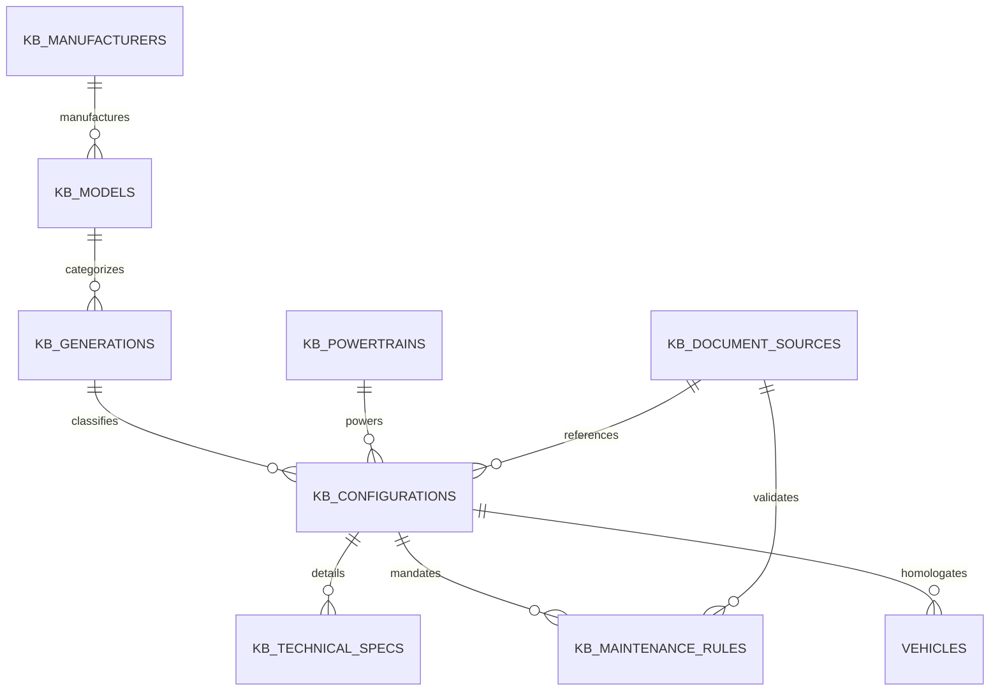

# Relational Schema: Vehicle Knowledge Base

## 1. Migration Specification

The relational Vehicle Knowledge Base is introduced via migration `0003_vehicle_knowledge_base.sql` applied by `DrizzleMigrator`. It defines 8 core tables with strict referential integrity, indexes on high-cardinality search filters, and an added foreign key in `vehicles`.

---

## 2. Entity-Relationship Topology

---

## 3. Table Definitions & Constraints

### 3.1. `kb_manufacturers`
Stores vehicle manufacturers / makes.
- `id` (UUID, Primary Key)
- `name` (VARCHAR(100), UNIQUE, NOT NULL): Canonical name (e.g. `'Renault'`, `'Volkswagen'`).
- `country` (VARCHAR(60)): Country of origin (e.g. `'Francia'`, `'Alemania'`).
- `founded_year` (INTEGER)
- `created_at`, `updated_at` (TIMESTAMP WITH TIME ZONE)

### 3.2. `kb_models`
Stores commercial vehicle models.
- `id` (UUID, Primary Key)
- `manufacturer_id` (UUID, FK -> `kb_manufacturers.id`, ON DELETE CASCADE, NOT NULL)
- `name` (VARCHAR(120), NOT NULL): Commercial model name (e.g. `'Logan'`, `'Golf'`).
- `segment` (VARCHAR(40)): Automotive market segment (e.g. `'B'`, `'C'`).
- `created_at`, `updated_at` (TIMESTAMP WITH TIME ZONE)
- Index: `idx_kb_models_mfr_name` on `(manufacturer_id, name)`.

### 3.3. `kb_generations`
Represents generation cycles and facelifts.
- `id` (UUID, Primary Key)
- `model_id` (UUID, FK -> `kb_models.id`, ON DELETE CASCADE, NOT NULL)
- `name` (VARCHAR(120), NOT NULL): Generation designation (e.g. `'Logan II Fase 2'`).
- `generation_code` (VARCHAR(50)): Internal chassis code (e.g. `'L52'`).
- `production_start_year` (INTEGER, NOT NULL)
- `production_end_year` (INTEGER, NULLABLE)
- `market` (VARCHAR(50), NOT NULL, DEFAULT `'Mercosur'`): Target regional market.
- Index: `idx_kb_generations_model_years` on `(model_id, production_start_year, production_end_year)`.

### 3.4. `kb_powertrains`
Stores internal combustion engines, electric motors, and hybrid architectures.
- `id` (UUID, Primary Key)
- `manufacturer_id` (UUID, FK -> `kb_manufacturers.id`, ON DELETE CASCADE, NOT NULL)
- `engine_code` (VARCHAR(60), NOT NULL): Engineering code (e.g. `'H4M'`, `'K7M'`, `'EA211'`).
- `commercial_name` (VARCHAR(120), NOT NULL): Marketing designation (e.g. `'1.6 16v SCe'`).
- `family` (VARCHAR(80)): Engine family (e.g. `'Nissan HR / Renault SCe'`).
- `displacement_cc` (INTEGER)
- `displacement_liters` (VARCHAR(20))
- `fuel_type` (VARCHAR(40), NOT NULL, DEFAULT `'Nafta'`)
- `valves` (INTEGER)
- `power_hp` (INTEGER)
- `timing_mechanism` (VARCHAR(40), NOT NULL): `'CADENA'` | `'CORREA'` | `'ENGRANAJE'` | `'DESCONOCIDO'`.
- `timing_observations` (TEXT): Critical mechanical notes regarding service requirements.
- `oil_viscosity_oem` (VARCHAR(60)): Standard viscosity (e.g. `'5W-30'`, `'5W-40 RN0710'`).
- `oil_capacity_liters` (VARCHAR(20))
- `verification_status` (VARCHAR(40), NOT NULL, DEFAULT `'VERIFIED'`)
- Index: `idx_kb_powertrains_code` on `(manufacturer_id, engine_code)`.

### 3.5. `kb_document_sources`
Tracks official literature supporting technical data.
- `id` (UUID, Primary Key)
- `title` (VARCHAR(255), NOT NULL): Document title.
- `publisher` (VARCHAR(150), NOT NULL): OEM or standards body (e.g. `'Renault Argentina'`).
- `publication_year` (INTEGER)
- `document_code` (VARCHAR(100)): Manual reference number or ISBN.
- `document_type` (VARCHAR(60), NOT NULL): `'MANUAL_PROPIETARIO'` | `'MANUAL_TALLER'` | `'CIRCULAR_TECNICA'`.
- `file_url` / `reference_link` (VARCHAR(500))

### 3.6. `kb_configurations`
Binds a generation, a powertrain, market, and transmission into a homologated vehicle configuration.
- `id` (UUID, Primary Key)
- `model_id` (UUID, FK -> `kb_models.id`, NOT NULL)
- `generation_id` (UUID, FK -> `kb_generations.id`, NOT NULL)
- `powertrain_id` (UUID, FK -> `kb_powertrains.id`, NULLABLE)
- `commercial_name` (VARCHAR(200), NOT NULL)
- `year_from` (INTEGER, NOT NULL)
- `year_to` (INTEGER, NULLABLE)
- `market` (VARCHAR(60), NOT NULL, DEFAULT `'Mercosur'`)
- `transmission` (VARCHAR(80), NOT NULL, DEFAULT `'Manual'`)
- `body_style` (VARCHAR(60))
- `trim` (VARCHAR(80))
- `source_id` (UUID, FK -> `kb_document_sources.id`, NULLABLE)
- `verification_status` (VARCHAR(40), NOT NULL, DEFAULT `'VERIFIED'`)
- Index: `idx_kb_configs_search` on `(model_id, year_from, year_to, market)`.

### 3.7. `kb_technical_specs`
Key-value matrix of verifiable parameters.
- `id` (UUID, Primary Key)
- `configuration_id` (UUID, FK -> `kb_configurations.id`, ON DELETE CASCADE, NOT NULL)
- `category` (VARCHAR(60), NOT NULL): `'ENGINE_OIL'` | `'COOLING'` | `'BRAKES'` | `'TRANSMISSION'` | `'SPARK_PLUGS'`.
- `spec_key` (VARCHAR(100), NOT NULL): Parameter key (e.g. `'oem_oil_norm'`, `'spark_plug_gap'`).
- `spec_value` (TEXT, NOT NULL): Value (e.g. `'RN 0710 / RN 0700'`, `'0.9 mm'`).
- `unit` (VARCHAR(30)): Measurement unit.
- `condition` (VARCHAR(100)): Environmental or operating condition.
- `source_id` (UUID, FK -> `kb_document_sources.id`, NULLABLE)
- `verification_status` (VARCHAR(40), NOT NULL, DEFAULT `'VERIFIED'`)
- Index: `idx_kb_specs_config_cat` on `(configuration_id, category)`.

### 3.8. `kb_maintenance_rules`
The core schedule table defining intervals, operations, and versioned audit trail.
- `id` (UUID, Primary Key)
- `configuration_id` (UUID, FK -> `kb_configurations.id`, ON DELETE CASCADE, NOT NULL)
- `category` (VARCHAR(60), NOT NULL): Maintenance category.
- `operation` (VARCHAR(40), NOT NULL): `'REPLACE'` | `'INSPECT'` | `'ADJUST'` | `'CLEAN'`.
- `title` (VARCHAR(200), NOT NULL)
- `description` (TEXT)
- `interval_km` (INTEGER, NULLABLE)
- `interval_months` (INTEGER, NULLABLE)
- `severe_interval_km` (INTEGER, NULLABLE)
- `severe_interval_months` (INTEGER, NULLABLE)
- `conditions` (TEXT): Operational caveats (severe service, taxi, mountain driving).
- `source_id` (UUID, FK -> `kb_document_sources.id`, NULLABLE)
- `verification_status` (VARCHAR(40), NOT NULL, DEFAULT `'VERIFIED'`): `'DRAFT'` | `'VERIFIED'` | `'DEPRECATED'`.
- `rule_version` (INTEGER, NOT NULL, DEFAULT 1)
- `previous_version_id` (UUID, NULLABLE)
- `is_active` (BOOLEAN, NOT NULL, DEFAULT true)
- `verified_by_user_id` (VARCHAR(128))
- `verified_at` (TIMESTAMP WITH TIME ZONE)
- `verification_notes` (TEXT)
- Index: `idx_kb_rules_config_cat` on `(configuration_id, category, is_active)`.

---

## 4. Vehicle Table Alteration
In `packages/database/src/schema/vehicles.ts`:
- Added column: `configuration_id` (UUID, REFERENCES `kb_configurations.id`, NULLABLE).
- Mapped in domain entity `Vehicle` as `configurationId?: string`.
