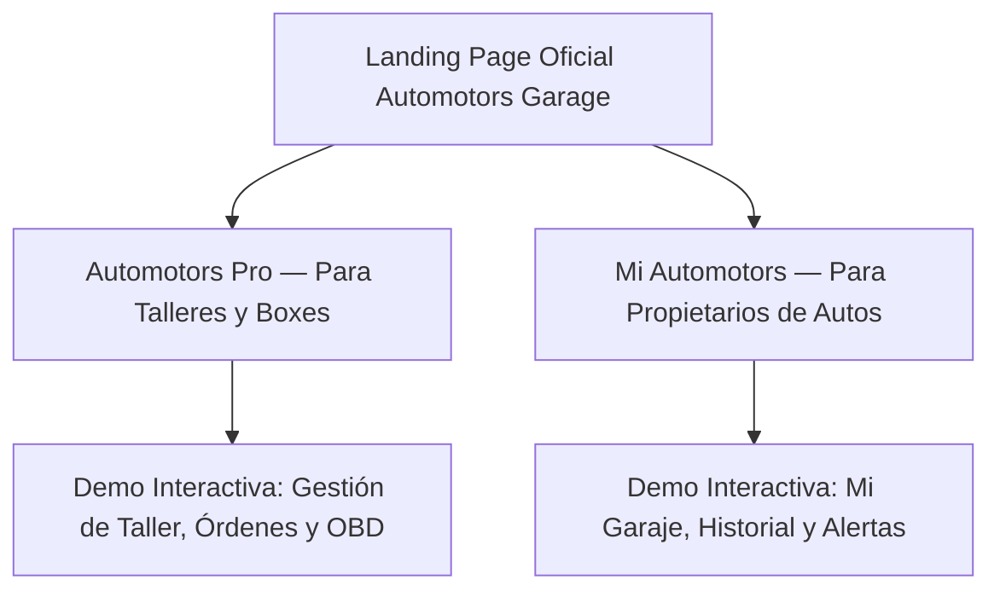

# Política de Contenido y Comunicación Pública — Automotors Garage

> **Fecha de Emisión**: 31 de Octubre de 2026  
> **Destinatarios**: Equipos de Diseño, Marketing, Producto y Desarrollo Frontend  
> **Ámbito de Aplicación**: Landing page pública, demos interactivas, documentación de preventa y material comercial de Automotors Garage.

---

## 1. Declaración de Principios de Ingeniería

En Automotors Garage consideramos que **la honestidad técnica es una ventaja competitiva fundamental**. En una industria saturada de afirmaciones exageradas, promesas vacías de "IA mágica" y métricas inventadas, nuestro posicionamiento se fundamenta en la solvencia arquitectónica, la precisión de los datos y el respeto estricto por la verdad técnica.

Cualquier contenido publicado en nuestros sitios oficiales o interfaces públicas debe ser verificable en el código fuente y en nuestra suite de pruebas automatizadas. Si una funcionalidad no está implementada y verificada, **no se comunica como existente**.

---

## 2. Reglas Específicas por Dominio

### 2.1 Testimonios, Clientes y Métricas de Uso
- **PROHIBIDO**: Inventar testimonios con nombres de talleres, fotos de stock de mecánicos o reseñas falsas (ej. *"Taller Don Juan aumentó 40% su facturación"*).
- **PROHIBIDO**: Publicar contadores o cifras artificiales (ej. *"Más de 500 talleres confían en nosotros"*, *"100.000 vehículos diagnosticados"*).
- **PERMITIDO**: Presentar casos de uso funcionales, flujos de trabajo simulados claramente rotulados como tales y beneficios arquitectónicos comprobables (ej. *"Cierre atómico de órdenes en menos de 60 segundos con Quick Service Entry"*).

### 2.2 Inteligencia Artificial y Diagnóstico Asistido
- **PROHIBIDO**: Usar frases como *"Mecánico con Inteligencia Artificial que reemplaza al taller"*, *"Diagnóstico infalible con 100% de precisión"* o *"Reparación automática garantizada"*.
- **OBLIGATORIO**: Presentar a la IA como una herramienta de asistencia y consulta que complementa el criterio del profesional.
- **OBLIGATORIO**: Incluir de forma visible el descargo técnico en toda explicación asistida:
  > *"Orientación técnica preventiva. La decisión de recambio o reparación debe validarse por inspección física en taller."*
- **OBLIGATORIO**: Explicar que los cálculos de mantenimiento se basan en un motor determinístico fundado en datos oficiales de manual de fábrica, no en alucinaciones estadísticas.

### 2.3 Compatibilidad Vehicular y Diagnóstico OBD-II
- **PROHIBIDO**: Asegurar *"Compatibilidad absoluta con el 100% de los autos del planeta"*.
- **PROHIBIDO**: Prometer *"Lectura directa desde el teléfono por Bluetooth sin escáner"* (la versión actual opera sobre datos de diagnóstico ingresados o generados por escáner estándar).
- **PERMITIDO**: Comunicar compatibilidad con el estándar internacional **SAE J2012** para códigos genéricos (P0xxx, C0xxx, B0xxx, U0xxx) y freeze frames. Aclarar que códigos específicos de fabricante requieren validación de catálogo o escáner dedicado.

### 2.4 Base de Conocimiento y Especificaciones de Fabricantes
- **PROHIBIDO**: Afirmar que disponemos de manuales completos y verificados de todas las marcas y modelos sin distinción.
- **PERMITIDO Y RECOMENDADO**: Enfatizar nuestra política estricta de calidad de datos:
  > *"Solo recomendamos fluidos y frecuencias respaldados por documentación oficial certificada. Los modelos en proceso de homologación técnica se indican como 'Pendientes de Verificación' y no emiten proyecciones apresuradas."*

### 2.5 Seguridad, Privacidad y Multi-Tenancy
- **PROHIBIDO**: Ofrecer acceso cruzado a datos de otros talleres o prometer "redes compartidas" sin consentimiento explícito.
- **PERMITIDO**: Enfatizar el aislamiento multi-tenant estricto a nivel base de datos: ningún taller puede acceder jamás a clientes, vehículos ni facturación de otro taller.
- **PERMITIDO**: Destacar que los datos del propietario particular pertenecen exclusivamente a él y solo se comparten con un taller cuando el vehículo ingresa formalmente a servicio.

---

## 3. Matriz de Claims: Permitidos vs Prohibidos

| Aspecto | Claim Prohibido (Rechazado) | Claim Permitido (Aprobado) | Justificación Técnica |
| :--- | :--- | :--- | :--- |
| **Público Objetivo** | "Un único software para todo el mundo sin distinciones" | "Dos experiencias diseñadas a medida: **Mi Automotors** para propietarios y **Automotors Pro** para talleres mecánicos." | La arquitectura implementa perfiles separados con roles, permisos y vistas totalmente adaptadas a cada necesidad. |
| **Tiempo de Carga de Órdenes** | "Crea órdenes en 1 segundo con inteligencia artificial" | "Quick Service Entry: registra servicios rutinarios en menos de 60 segundos con confirmación técnica obligatoria." | El contrato Zod (`QuickServiceEntrySchema`) exige revisión humana explícita (`humanConfirmed: true`) para prevenir errores de taller. |
| **Diagnóstico OBD** | "Detecta todas las fallas mecánicas de tu auto mágicamente" | "Decodificación estandarizada de fallas OBD-II bajo protocolo SAE J2012 con checklist técnico para el mecánico." | El sistema procesa códigos de falla estandarizados; la falla física real siempre debe ser verificada en el taller. |
| **Planes de Mantenimiento** | "Sabemos con exactitud cuándo se va a romper tu auto" | "Proyecciones preventivas basadas en kilometraje, tiempo e historial de servicios certificados." | Si los datos históricos son escasos o la ficha técnica no está certificada, el sistema devuelve `INSUFFICIENT_DATA`. |
| **Infraestructura y Datos** | "Tus datos viven en una nube mágica sin detalles" | "Arquitectura PostgreSQL relacional estricta, con soporte transaccional ACID y migraciones reversibles." | 26 tablas relacionales normalizadas y soporte para PostgreSQL 16 nativo de alta disponibilidad. |

---

## 4. Diferenciación de Producto en la Landing Page

La landing page principal debe estructurarse con dos caminos claros para el visitante:

1. **Automotors Pro**:
   - Orientado a talleres mecánicos independientes, lubricentros y talleres de flota.
   - Énfasis en: productividad, Quick Service, trazabilidad de órdenes, fidelización del cliente y profesionalismo en diagnósticos.
2. **Mi Automotors**:
   - Orientado a dueños particulares de automóviles.
   - Énfasis en: historial digital de mantenimiento, valor de reventa del vehículo garantizado por registros certificados, alertas de mantenimiento preventivo y comprensión clara del estado mecánico.
